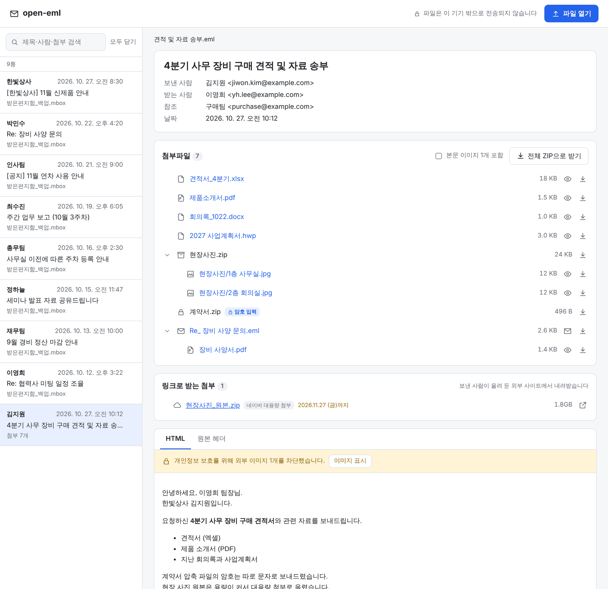
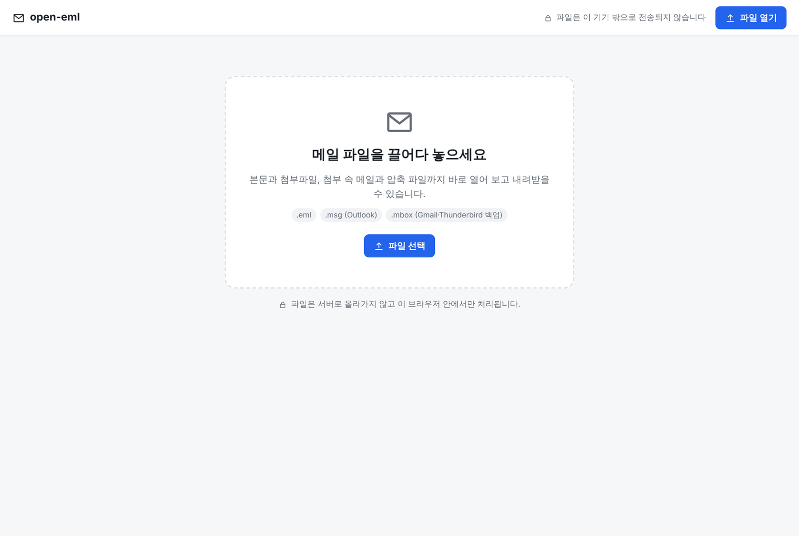
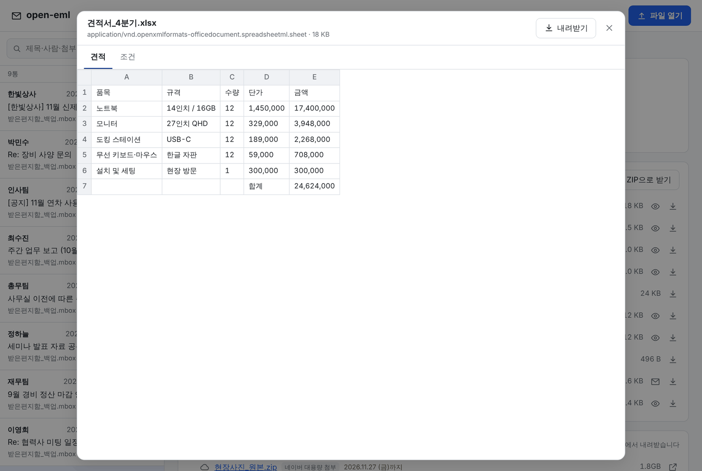
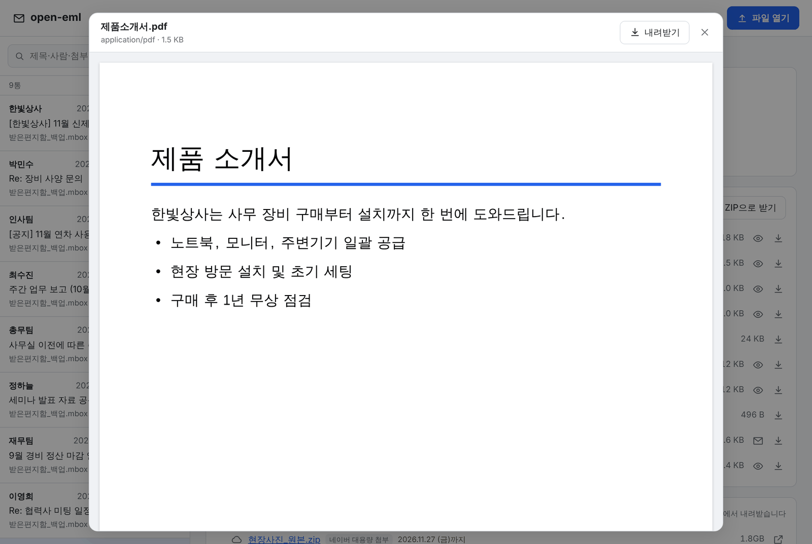
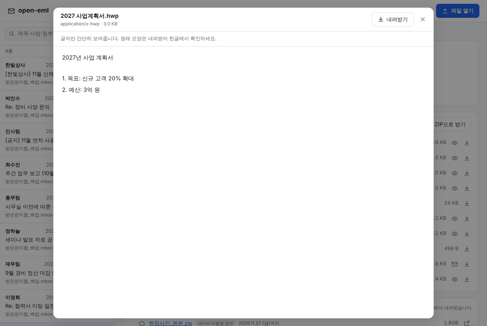
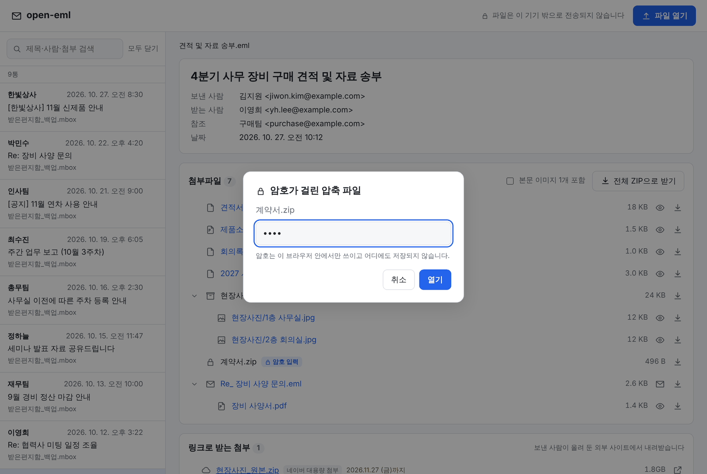
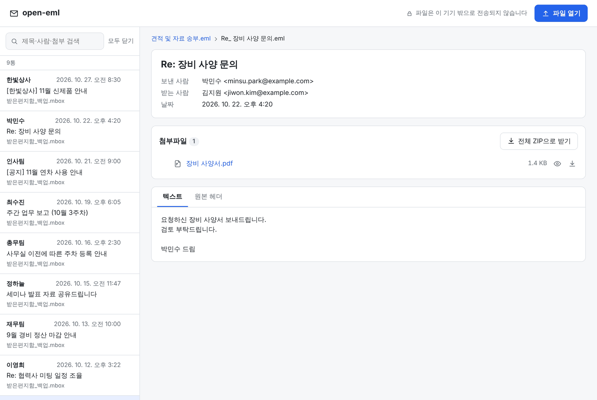
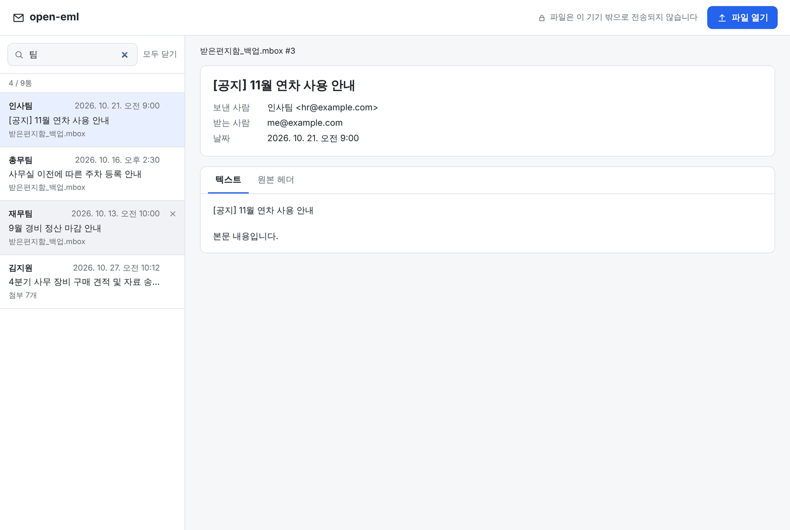
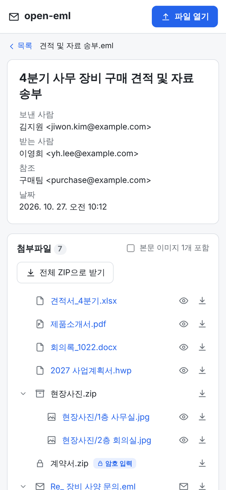
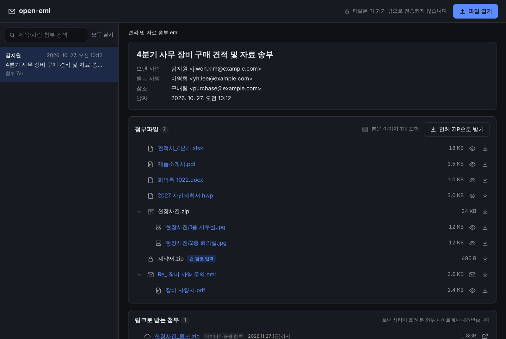

# open-eml

  

**메일 파일(`.eml` · `.msg` · `.mbox`)을 브라우저에서 바로 열어 보고, 안에 든 첨부파일까지 모두 꺼내 받는 이메일 뷰어**

메일 프로그램 없이, 설치 없이, 파일을 끌어다 놓기만 하면 됩니다. 메일은 서버로 올라가지 않고 내 브라우저 안에서만 열립니다.



> 화면에 나오는 회사, 사람, 메일 주소는 모두 예시입니다.

> [!NOTE]
> **지금은 베타 버전입니다.** 주요 기능은 동작하지만, 메일 서비스나 프로그램에 따라 일부 메일이 깨져 보이거나 열리지 않을 수 있습니다.
> 이런 메일을 만나면 [Issues](https://github.com/shun1403/open-eml/issues)로 알려 주세요. 실제 메일을 그대로 올리지 말고 개인정보를 지운 샘플로 부탁드립니다.
> open-eml은 열어 본 원본 파일을 바꾸거나 지우지 않습니다.

## 이런 때 쓰세요

- 메일을 **`.eml` 파일로 내보냈는데** 열어 볼 프로그램이 없을 때
- 거래처에서 받은 **Outlook `.msg`** 파일이나, 첨부가 **`winmail.dat`** 하나로 뭉쳐 와서 열리지 않을 때
- **Gmail·Thunderbird 백업(`.mbox`)** 에서 예전 메일과 첨부를 찾아야 할 때
- 첨부된 메일 안의 첨부, 압축 파일 안의 파일까지 **한 번에 꺼내고** 싶을 때
- 엑셀, PDF, 한글 문서를 **내려받기 전에 미리** 보고 싶을 때

## 특징

- **설치 없이 브라우저에서.** 파일을 끌어다 놓으면 바로 열립니다.
- **서버 업로드 없음.** 메일과 첨부는 이 기기 밖으로 전송되지 않습니다.
- **한글에 강합니다.** EUC-KR·CP949 메일, 한국어 Outlook의 `.msg`, 한국어 Windows에서 만든 압축 파일 이름도 깨지지 않습니다.
- **안의 파일까지 전부.** 첨부된 메일, ZIP, `winmail.dat`을 트리로 펼쳐 보여주고 하나씩 또는 한 번에 내려받습니다.
- **안전하게.** 메일 속 스크립트는 실행되지 않고, 읽음 확인용 추적 이미지는 기본으로 막습니다.

## 사용 방법

### 1. 메일 파일 열기

화면에 파일을 끌어다 놓거나 **파일 열기** 버튼을 누르세요. 여러 파일을 한 번에 열 수 있습니다.



### 2. 메일과 첨부파일 보기

메일을 열면 보낸 사람, 받는 사람, 날짜와 함께 첨부파일 목록이 나옵니다.

- **압축 파일**과 **첨부된 메일**은 왼쪽 화살표(›)를 눌러 안을 펼칩니다.
- **눈 아이콘**: 파일을 내려받지 않고 바로 미리봅니다.
- **아래 화살표 아이콘**: 파일 하나를 내려받습니다.
- **전체 ZIP으로 받기**: 첨부를 한 번에 받습니다. 첨부된 메일 안의 첨부는 `메일이름_첨부/` 폴더에 따로 담깁니다.
- **실행 파일**(`.exe` 등)이나 **매크로 문서**(`.xlsm` 등)는 **주의** 표시가 붙고, 내려받기 전에 한 번 더 묻습니다.

본문에 외부 이미지가 있으면 개인정보 보호를 위해 막아 두고 개수만 알려줍니다. **이미지 표시**를 누르면 그때 불러옵니다.

### 3. 내려받지 않고 미리보기

파일 이름이나 눈 아이콘을 누르면 미리보기 창이 열립니다.

| Excel | PDF | 한글(HWP) |
|---|---|---|
|  |  |  |

이미지, PDF, 텍스트, 오디오·비디오, Word(`.docx`), Excel(`.xlsx` `.xls` `.csv`), 한글(`.hwp` `.hwpx`)을 미리볼 수 있습니다. Word와 한글 문서는 글자와 표 위주로 간단히 보여주므로, 원래 모양은 내려받아 확인하세요.

### 4. 암호가 걸린 압축 파일 열기

자물쇠가 붙은 압축 파일 옆의 **암호 입력**을 누르고 암호를 넣으면 안의 파일이 펼쳐집니다. 암호는 브라우저 안에서만 쓰이고 저장되지 않습니다.



### 5. 첨부된 메일 따라 들어가기

전달받은 메일처럼 메일 안에 메일이 첨부돼 있으면 파일 이름이나 봉투 아이콘을 눌러 그 메일을 엽니다. 위쪽 경로를 눌러 원래 메일로 돌아옵니다.



### 6. 링크로 받은 첨부 모아 보기

용량이 커서 링크로 보낸 첨부(네이버 대용량 첨부, Google Drive, OneDrive, Dropbox 등)는 **링크로 받는 첨부**에 따로 모아, 파일 이름·크기·다운로드 기한을 보여줍니다(맨 위 화면 참고). 누르면 해당 사이트가 새 창으로 열립니다.

### 7. 백업 파일(`.mbox`)에서 메일 찾기

Gmail·Thunderbird 백업 파일을 열면 메일이 목록으로 펼쳐집니다. 수천 통짜리 큰 파일도 나눠 읽기 때문에 금방 열리고, 고른 메일만 그때그때 엽니다. 위쪽 검색창에서 제목, 사람, 첨부 이름으로 찾을 수 있습니다.



### 휴대폰과 다크 모드

| 휴대폰 | 다크 모드 |
|---|---|
|  |  |

시스템 설정에 따라 밝은 화면과 어두운 화면이 자동으로 바뀝니다.

## 메일 파일은 어디서 구하나요?

| 서비스 | 방법 | 나오는 파일 |
|---|---|---|
| Gmail | 메일을 열고 오른쪽 위 ⋮ → **메일 다운로드** | `.eml` |
| Gmail 전체 | [Google 테이크아웃](https://takeout.google.com/)에서 Gmail 선택 | `.mbox` |
| 네이버 메일 | 메일을 열고 **더보기** → **PC에 저장** | `.eml` |
| Outlook (Windows 앱) | 메일을 바탕화면으로 끌어다 놓기, 또는 **파일** → **다른 이름으로 저장** | `.msg` |
| Thunderbird | 메일을 고르고 **파일** → **다른 이름으로 저장** → **파일** | `.eml` |

메뉴 이름은 서비스 업데이트에 따라 조금 다를 수 있습니다.

## 지원 형식

| 구분 | 형식 |
|---|---|
| 메일 파일 | `.eml`, Outlook `.msg`, `.mbox` (Gmail, Thunderbird) |
| 펼쳐 볼 수 있는 첨부 | 첨부된 메일(`.eml`, `.msg`), `.zip` (암호 ZIP 포함), Outlook `winmail.dat` |
| 미리보기 | 이미지, PDF, 텍스트, 오디오, 비디오, Word `.docx`, Excel `.xlsx` `.xls` `.csv`, 한글 `.hwp` `.hwpx` |

## 개인정보와 보안

- **메일은 서버로 가지 않습니다.** 파일 읽기, 압축 풀기, 미리보기가 모두 브라우저 안에서 일어납니다.
- **본문 속 코드는 실행되지 않습니다.** HTML 본문은 정화한 뒤 스크립트가 막힌 영역에 띄웁니다.
- **추적 이미지를 막습니다.** 외부 이미지는 **이미지 표시**를 누르기 전까지 불러오지 않습니다.
- **위험한 첨부는 경고합니다.** 실행 파일과 매크로 문서는 내려받기 전에 한 번 더 확인합니다.
- **지나치게 큰 압축은 멈춥니다.** 압축을 풀면 비정상적으로 커지는 파일(압축 폭탄)은 펼치지 않습니다.

## 자주 묻는 질문

**한글이 깨져 보여요.**
오래된 메일 프로그램이 문자 정보를 빠뜨리면 그럴 수 있습니다. 개인정보를 지운 샘플 파일과 함께 [Issues](https://github.com/shun1403/open-eml/issues)에 알려 주세요.

**한글 문서가 원래 모양대로 안 보여요.**
한글(`.hwp`) 미리보기는 글자만 꺼내 보여줍니다. 배포용 문서는 문서 안에 저장된 짧은 미리보기 글만 보입니다. 원래 모양은 내려받아 한글 프로그램에서 확인하세요.

**`.msg`나 `.mbox` 말고 다른 형식도 되나요?**
지금은 `.eml`, `.msg`, `.mbox`를 엽니다. 필요한 형식이 있으면 Issues에 남겨 주세요.

## 직접 실행하기

웹 배포는 준비 중입니다. 지금은 내 컴퓨터에서 직접 실행해서 쓸 수 있습니다. [Node.js](https://nodejs.org/) 20.19 이상이 필요합니다.

```bash
git clone https://github.com/shun1403/open-eml.git
cd open-eml
npm install
npm run dev
```

브라우저에서 `http://localhost:5173`을 열면 됩니다. 업데이트를 받을 때는 `git pull` 후 `npm install`을 다시 실행하세요.

| 명령어 | 설명 |
|---|---|
| `npm run dev` | 개발 서버 실행 |
| `npm run build` | 배포용 빌드 (`dist/`) |
| `npm run preview` | 빌드 결과 미리보기 |
| `npm test` | 테스트 실행 |
| `npm run typecheck` | 타입 검사 |

### 프로젝트 구조

```
src/
├─ core/        메일·첨부 해석 (화면과 분리된 순수 로직, 테스트 대상)
│  ├─ parser.ts   형식별 파서를 묶고 첨부를 재귀로 펼친다
│  ├─ msg.ts      Outlook .msg
│  ├─ tnef.ts     winmail.dat
│  ├─ rtf.ts      Outlook RTF 본문
│  ├─ mbox.ts     .mbox 나눠 읽기
│  ├─ zip.ts      ZIP·암호 ZIP
│  ├─ hwp.ts      한글 문서 글자 꺼내기
│  ├─ html.ts     본문 정화·외부 이미지 차단
│  └─ links.ts    링크로 보낸 첨부 찾기
├─ worker/      큰 메일을 화면 멈춤 없이 읽는 Web Worker
├─ previews/    PDF·Word·Excel·한글 미리보기 (필요할 때만 불러옴)
└─ components/  화면
tests/          자동 테스트
```

## 기술 스택

- [React](https://react.dev/) + [TypeScript](https://www.typescriptlang.org/) + [Vite](https://vite.dev/)
- [postal-mime](https://github.com/postalsys/postal-mime): MIME 메일 파싱
- [DOMPurify](https://github.com/cure53/DOMPurify): HTML 본문 정화
- [fflate](https://github.com/101arrowz/fflate), [zip.js](https://github.com/gildas-lormeau/zip.js): ZIP 만들기 / 풀기 (암호 ZIP 포함)
- [msgreader](https://github.com/HiraokaHyperTools/msgreader): Outlook `.msg` 파싱
- [PDF.js](https://github.com/mozilla/pdf.js): PDF 미리보기
- [mammoth](https://github.com/mwilliamson/mammoth.js): Word 미리보기
- [SheetJS](https://sheetjs.com/): Excel 미리보기
- [cfb](https://github.com/SheetJS/js-cfb): 한글(HWP) 문서 읽기

## 로드맵

- [x] 웹앱: `.eml` · `.msg` · `.mbox`, 첨부 펼치기, 미리보기 (베타)
- [ ] 웹 배포: 설치 없이 링크로 바로 쓰기
- [ ] 실제 메일로 안정화한 뒤 정식 버전(1.0) 내기
- [ ] 데스크톱 앱 (Windows / macOS / Linux): 메일 파일을 더블클릭해서 바로 열기

## 기여하기

버그 제보와 기능 제안은 [Issues](https://github.com/shun1403/open-eml/issues)에 남겨 주세요. 메일이 제대로 열리지 않는 경우, 개인정보를 지운 샘플 파일을 함께 첨부해 주시면 큰 도움이 됩니다.

## 라이선스

[MIT](LICENSE)
